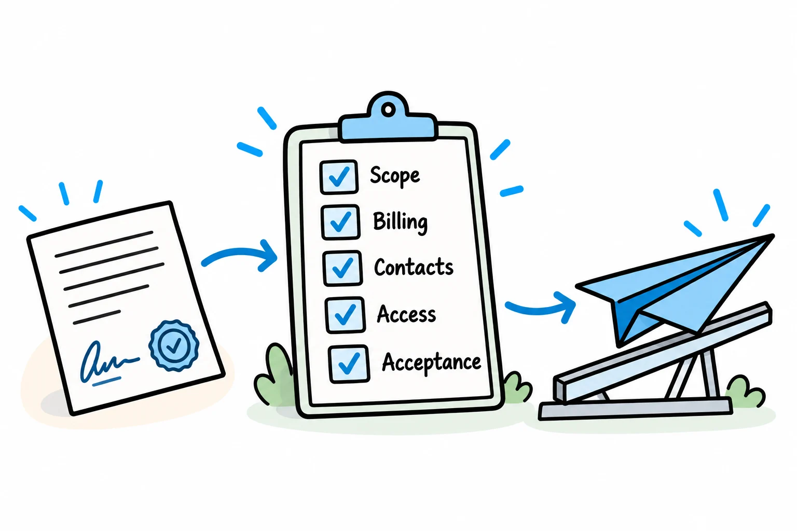
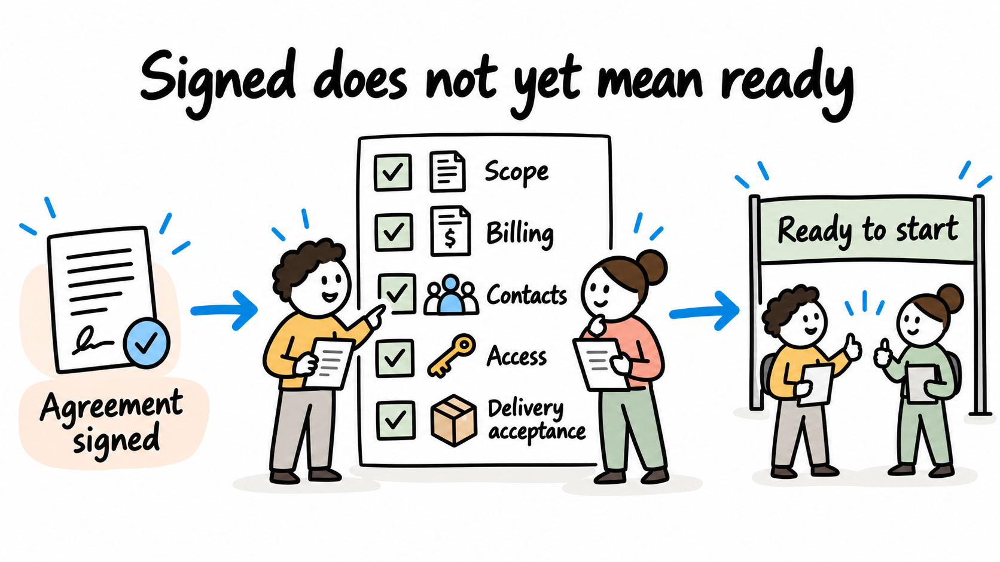
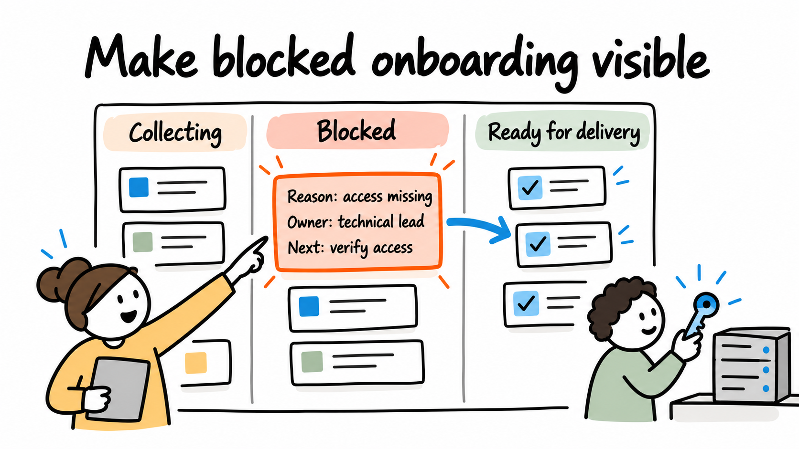

# Customer onboarding automation: from signed agreement to a ready-to-start client

By [Jateen Narsai](author-jateen-narsai.md)

*Confirm readiness before handing work into delivery.*

A new client has signed the agreement, but your delivery team is still waiting for the information or access it needs to start. Define what readiness means for that service, then connect the information collection, checks and internal handoffs needed to reach it.

Verified contacts, an agreed scope, billing details or authorised system access may still be outstanding. Automating welcome messages while those dependencies remain unclear leaves the underlying follow-up work unchanged.

Clearer requests, agreed ownership and fewer repeated checks can make the process easier alongside any automation.

## Define what ready means

*A signed agreement starts onboarding; readiness for delivery completes it.*

Start with the service you're onboarding, because readiness varies with the work. Ask the receiving team what it needs to accept responsibility for delivery and what can safely arrive later.

Separate required information from optional preferences. Collecting everything you might someday use increases the work for the client and the team checking it. Record why each required item is needed and who accepts it.

Name one readiness owner. Other people can complete checks, but someone needs authority to say that the handoff is complete or that a specific outstanding item prevents it.

## Map one onboarding workflow

**Illustrative example:** an IT support provider is onboarding a customer for an agreed support service. This is a design example, not a client engagement or a universal checklist.

| Readiness condition | Responsible role | Completion evidence |
|---|---|---|
| Service scope and start conditions agreed | Account owner | Accepted agreement and current scope reference |
| Customer and billing records confirmed | Finance contact | Correct billing entity and linked customer records |
| Support contacts and escalation route agreed | Service coordinator | Approved contact list and responsibilities |
| Required system access established | Authorised technical owner | Access verified through the agreed secure process |
| Delivery team accepts the handoff | Support lead | Readiness decision recorded against the current scope |

Use the [readiness and ownership worksheet](assets/onboarding-readiness.csv) to adapt these conditions. Your service may need different checks. Industry-specific requirements need their own review rather than being assumed from this general example.

## Use one request reference across the handoff

Create an onboarding reference linked to the agreed customer and service. Use it to show which information is outstanding, who owns the next action and what's already been accepted.

Avoid asking the client to provide the same information in several forms. Where systems already hold an approved value, reuse it under an agreed ownership rule. The [data-entry guide](02-reduce-duplicate-data-entry.md) explains how to handle matching, corrections and conflicting fields.

Keep credentials and sensitive access material out of ordinary onboarding forms and notification emails. The technical owner should arrange access through the organisation's approved method. The onboarding record needs to show the status and responsible owner, rather than expose the credential itself.

## Automate collection and follow-up with clear conditions

A practical sequence is:

1. Open the request when the agreed commercial trigger occurs.
2. Request only the information required for this service and client situation.
3. Validate the submission and assign checks to the responsible roles.
4. Remind the owner of a specific outstanding item, using the agreed calendar.
5. Present the completed checks to the delivery lead for handoff acceptance.

An acknowledgement confirms receipt; acceptance confirms that the required check is complete. Keep those states separate so an uploaded document isn't automatically treated as verified.

Stop reminders when the relevant item is accepted, waived under policy or no longer needed. Once a customer has provided everything requested, they shouldn't keep receiving a generic “complete your onboarding” message.

## Make blocked cases visible

*Give every blocked case a clear reason, owner and next action.*

Record the reason for each exception and the next action needed to resolve it. If a contact must authorise access, tell the client which contact you need; “waiting for client” doesn't explain the delay.

The [exception checklist](assets/onboarding-exceptions.csv) covers missing information, invalid submissions, duplicates, scope changes and a failed receiving-system update. Its expected outcomes are proposed acceptance criteria, with actual results left for implementation testing.

If the client changes the service scope during onboarding, identify which accepted checks remain valid. New access requirements may need a new technical review. Check readiness against the revised scope, even if the agreement changed only through a new attachment.

If a start date arrives before readiness is confirmed, route that decision to the owner. An automatic calendar event shouldn't waive required checks or promise delivery the team can't support.

## Close the receiving handoff

*A completed handoff includes confirmation from the team receiving the work.*

The delivery team should be able to see the current scope, relevant customer references, accepted checks and any explicitly agreed outstanding items. Record who accepted the handoff and when.

If creating the delivery record fails, retain a visible incomplete state and reconcile the outcome before retrying. Repeated triggers should refer to the same intended setup rather than create additional customer projects or support accounts.

Keep ownership clear after onboarding closes. A later change to the billing entity or authorised contacts needs a maintenance process; it shouldn't reopen every completed task without a reason.

## Measure readiness and repeat work

Track the elapsed time from the agreed trigger to delivery acceptance. Break it into time awaiting client input, internal checks and the final handoff. Measure how many submissions are returned for correction and how much manual follow-up remains.

Review open and stalled onboarding cases as well as completed ones. If the slowest cases stay open, an average based only on completed cases won't show the full delay. The [bottleneck guide](04-identify-process-bottlenecks.md) provides a method for that investigation.

## Improve the handoff that needs repeated follow-up

We help make onboarding easier for clients and the teams receiving their work. We examine a recent onboarding case, identify repeated requests and unclear handoffs, and agree what readiness means with the people responsible for delivery.

We can introduce the revised process, configure information collection or build the required connections, then test the handoff and establish ownership. Bring one service, its onboarding checklist and a recent case that needed repeated follow-up.

[See how we improve onboarding handoffs](/services/business-operations-improvement/), or explore our broader [business improvement and solution delivery services](/#services).

[Discuss your customer onboarding workflow with Solvero](/#contact).
