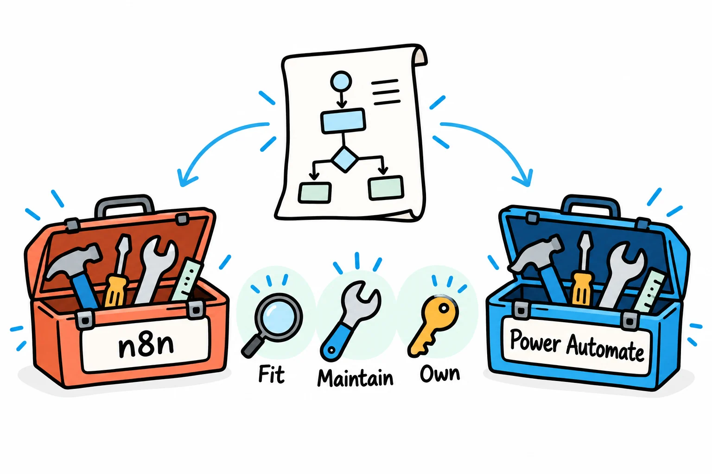
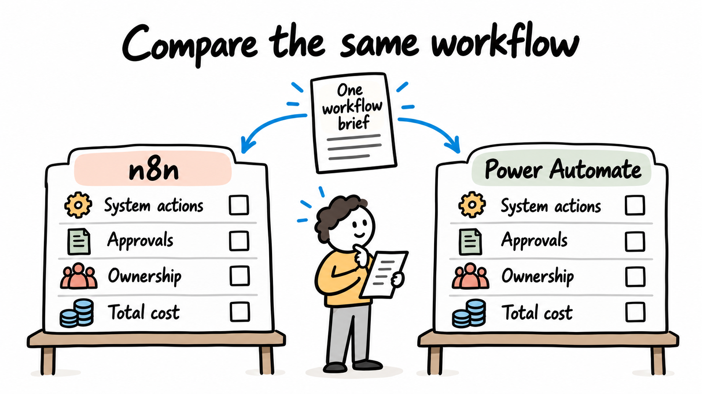
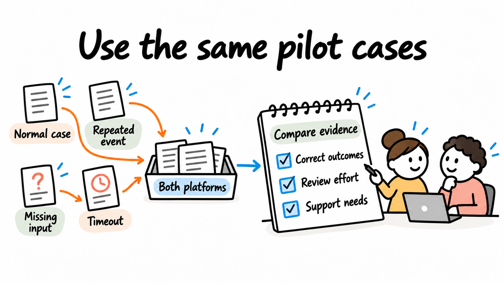

# n8n vs Power Automate: how to choose for your business workflow

By [Jateen Narsai](author-jateen-narsai.md)

*Choose for the workflow and the people who will operate it.*

Your workflow needs to carry out the required system actions, follow the approval policy and be manageable for the people supporting it. To choose between n8n and Power Automate, compare the same workflow against those requirements, its operating arrangements and total cost. Both deserve evaluation where they fit.

If your workflow is closely tied to an existing Microsoft environment and its operating team, Power Automate is a practical candidate to assess. Consider n8n when its integration approach or self-hosting option matches your organisation's needs. Treat these as starting hypotheses to test in a pilot; they don't establish a performance ranking.

The aim is a maintainable process that does what your business needs. Platform selection is one decision within that delivery.

## Write one workflow brief for both platforms

*Compare both platforms against the same operating requirements.*

Define the trigger, inputs, finishing condition and manual decisions. Name the applications and the specific actions needed in each. Include the expected volume, peak demand, sensitive-data handling and recovery owner.

For an **illustrative evaluation**, consider an equipment-purchase request that needs validation, one or more approvals, creation of a purchasing record and confirmation to the requester. It must also handle an absent approver, a changed amount and an uncertain system update.

Use the same fields, authority matrix and acceptance cases in both versions. Comparing a simple notification in one platform with a complete approval process in the other won't help you choose.

## Verify actions rather than counting integrations

A connector or node name is a starting point. Confirm whether it supports the required operation, fields, authentication method and edition of the destination product.

Where a required action needs an API call or another integration approach, include the setup, permissions and maintenance in the comparison. Check that a failed request can be detected and reconciled using the available interface.

Use the [platform evaluation matrix](assets/platform-evaluation-matrix.csv) to record evidence and unresolved questions. Treat each mandatory requirement as a pass-or-fail condition. A high overall preference score can't compensate for a required action that hasn't been shown to work.

## Compare the operating fit

*Include ownership, access and recovery responsibilities in the platform decision.*

| Consideration | n8n evaluation | Power Automate evaluation |
|---|---|---|
| Existing systems | Verify required nodes or API operations and credentials | Verify required connectors or API operations and credentials |
| Deployment | Assess n8n Cloud or a self-hosted arrangement | Assess the Microsoft cloud-flow environment and any required local connectivity |
| Approvals | Assess the request, reviewer experience, authority checks and durable state | Assess supported approval actions and their fit with the authority policy |
| Ownership | Identify who can maintain workflows and, if applicable, hosting | Identify who can maintain flows, connections, environments and licensing |
| Cost | Model the selected edition, executions, hosting and external services | Model the selected licensing context, entitlements, capacity and external services |

[n8n's hosting documentation](https://docs.n8n.io/hosting/) describes self-hosting and the operational knowledge it requires. With self-hosting, you'll need to plan updates, backups and recovery. Check the edition too: self-hosting doesn't establish that every governance feature is included.

[Microsoft's getting-started documentation](https://learn.microsoft.com/en-us/power-automate/getting-started) is a starting point for Power Automate's cloud-flow environment. Confirm local data access and administrator policies with the team responsible for your Microsoft environment. Local connectivity and the location of the orchestration service are separate requirements to check.

## Test approvals as a complete experience

Power Automate documents approval types such as everyone-must-approve, first-response and sequential decisions. Check the [approval documentation](https://learn.microsoft.com/en-us/power-automate/get-started-approvals) against the policy you need to implement.

n8n's [Wait node documentation](https://docs.n8n.io/integrations/builtin/core-nodes/n8n-nodes-base.wait.md) describes pausing and resuming execution. A paused workflow still needs the surrounding approval design. You'll need to identify eligible reviewers, show the correct request revision and record the decision.

For either candidate, test what happens when someone changes an amount after approval, a delegate lacks authority or an old response arrives late. The [approval workflow guide](03-approval-workflow-automation.md) defines those business cases independently of the platform.

## Compare cost using the intended configuration

[n8n's pricing page](https://n8n.io/pricing/) describes execution-based allowances for its paid plans. Confirm how the proposed workflow's triggers, retries and operating pattern affect the applicable allowance, and add hosting and other service charges where relevant.

[Microsoft's licence types](https://learn.microsoft.com/en-us/power-platform/admin/power-automate-licensing/types) distinguish user and capacity licensing and the entitlements available under different arrangements. Don't assume an existing Microsoft subscription covers every required connector or scenario.

Use the current vendor terms for the exact deployment and users involved. Include internal support effort, access administration and review work.

A single subscription price can't establish which platform will cost less overall. The [project-cost guide](07-workflow-automation-project-cost.md) helps compare the scope around those platform costs.

## Run a bounded comparison

The [shared pilot test brief](assets/platform-pilot-tests.csv) provides the same normal and exception scenarios for both platforms. This evaluation plan has blank actual-results fields. It hasn't been run as a benchmark.

For each candidate, record the configuration, required entitlements and evidence that the expected business outcome occurred. Measure operator effort and recovery steps as well as successful execution. Use representative test data and approved access, with safeguards against creating purchasing commitments during the demonstration.

Assess whether another team member can diagnose a failure and maintain a small change using the handover documentation. The maintainable choice depends on who will operate it after the initial builder has left.

*A shared pilot produces evidence that a feature list cannot provide.*

## Make a workflow-specific decision

An organisation with an established Microsoft operating team and a suitable approval pattern may find Power Automate a sensible option to pilot. A team needing an n8n-supported integration approach or a self-hosted runtime may find n8n worth piloting. Required capabilities, permissions and ongoing ownership must still be verified in either case.

Document why the selected option fits the requirements and what remains unresolved. If neither meets the mandatory conditions within a practical scope, change the design before committing to the platform.

## Discuss the workflow before selecting a tool

We help you turn a platform comparison into a decision about a working business solution. We define the workflow and acceptance criteria with your team, check the system actions and trial the options against the same cases.

After the approach is agreed, we can implement the workflow or integration through testing and handover. If your development team is involved, we'll make requirements, dependencies and acceptance decisions clear. Bring the systems, the required outcome and the people who will operate the solution.

[See how we build around your systems and requirements](/services/new-business-capabilities/), or explore our broader [business improvement and solution delivery services](/#services).

[Discuss your automation platform choice with Solvero](/#contact).
