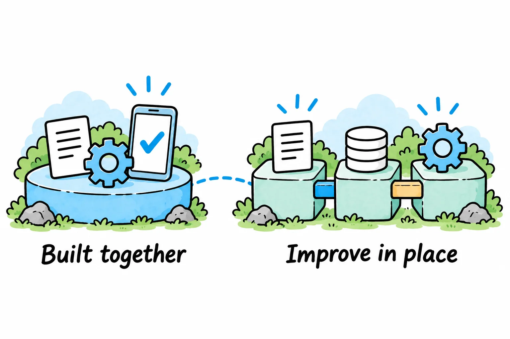
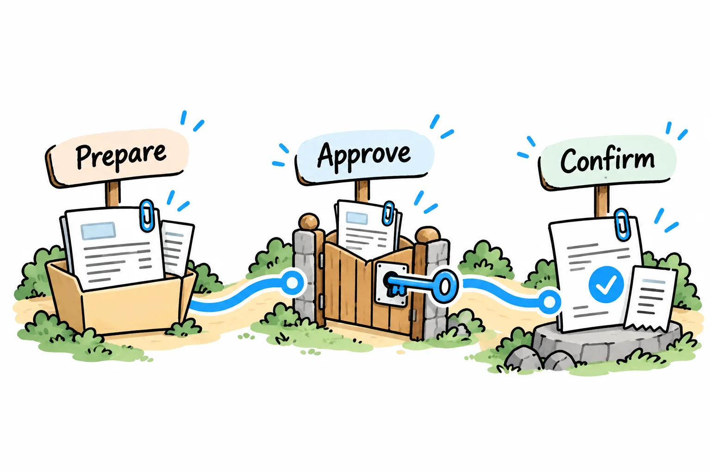
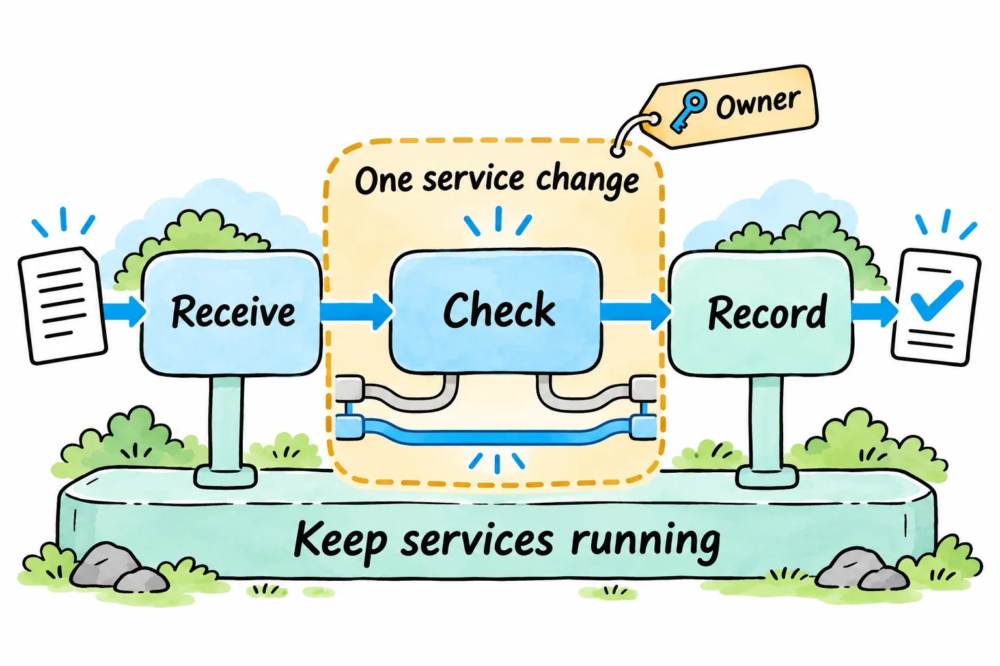
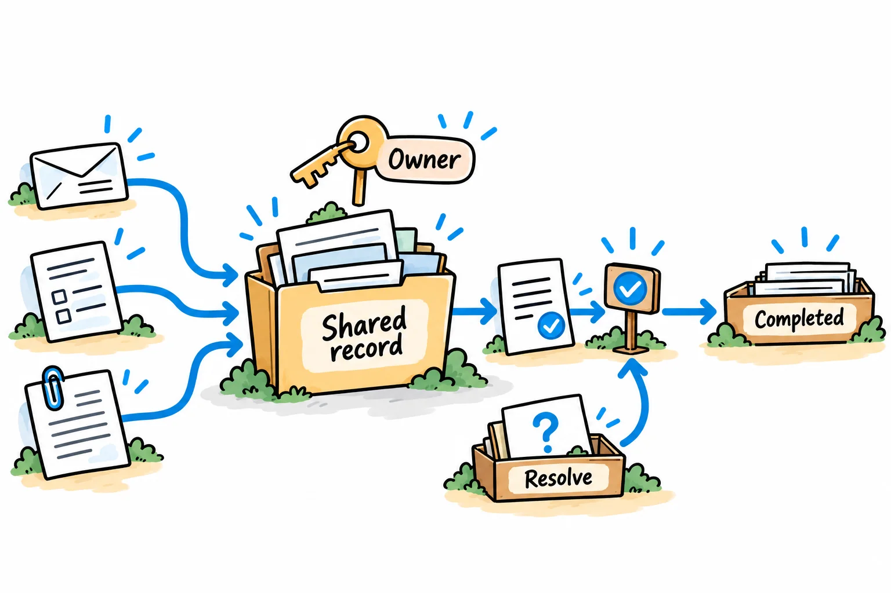

# What established banks and insurers can learn from Bank Zero

By [Jateen Narsai](/authors/jateen-narsai/)

*An established institution can adapt the design principles of a purpose-built platform while working with its existing systems.*

The December 2021 case study reported that 2 people managed Bank Zero's LinuxONE platform.

[IBM's account](https://www.ibm.com/case-studies/bank-zero) connects the small platform-management team to the bank's low-fee model.

For an established bank or insurer, the question is which of Bank Zero's choices could help it deliver a service with less operating effort. Answering that requires looking at what the bank made possible, how its technology choices supported the banking service and what changes when an institution already has customers and systems to maintain.

## What Bank Zero made possible

Bank Zero put a branchless banking service into operation for individuals and businesses, with zero monthly account fees and free basic transactions.

Bank Zero also gives business customers control over payment preparation and authorisation. Bank Zero describes configurable authorisation chains, bulk payment uploads and a direct Xero connection for importing transaction data. These business features bring approval and accounting connections into the service customers use to move money.

*Keep preparation, authorisation and confirmation connected within the payment workflow. This is a conceptual illustration, not a view of Bank Zero's app.*

We recommend assessing the account fee alongside the payment controls and the administration customers still need to perform.

In September 2026, Bank Zero reported reaching its first monthly break-even result in August. [ITWeb's report](https://www.itweb.co.za/article/bank-zero-reaches-break-even-after-nearly-five-years/LPwQ57lbVQzqNgkj) also records the bank's expectation of uneven monthly earnings afterwards. The milestone supports a discussion about its operating model; it doesn't establish sustained profitability or isolate the financial contribution of its technology.

For established institutions, we recommend designing the customer service and the work required to operate it together.

## Why its technology approach supported the model

Bank Zero could design its banking platform around the service it intended to offer. Its [own explanation](https://www.bankzero.co.za/faqs/) says the team built the core platform itself using open-source components and chose against buying and customising a traditional banking package.

That gave it responsibility for the software and control over its design. Open-source components supplied part of the foundation; the bank still had to build, test, secure and operate the complete service.

For an enterprise, we recommend designing payment initiation, authorisation, recording and operational handling as one workflow. Removing unnecessary handoffs can reduce the work people must perform and support.

Infrastructure decisions followed the intended operation too. IBM's historical case study describes testing alternatives against performance requirements, choosing LinuxONE with Ubuntu and using platform automation to keep management effort low. IBM's case study reports the bank's experience; it doesn't provide an independent cost comparison with other banks.

IBM's account describes cost and ease of management as requirements for choosing the platform.

When assessing a new capability, we recommend considering operating effort alongside functionality. Ask how many people must intervene, which systems must exchange or reconcile information and what happens when processing fails. Include the continuing work of support, reconciliation and change in the decision.

Building software internally is one possible response to those requirements. An existing product or a well-designed integration may fit them better elsewhere. The decision needs to account for the skills, maintenance and control each option requires.

## What changes for an established institution

An established bank or insurer starts with an additional responsibility: changing the service while continuing to honour existing commitments. Its products, records, interfaces and operating arrangements place constraints on the route forward.

Bank Zero's own FAQ says it doesn't offer credit. A bank with lending products therefore has a different scope to support; an insurer also has policy and claims obligations outside Bank Zero's banking proposition. Comparing total headcount or customer fees without accounting for those differences would tell us little about technology efficiency.

The [Federal Reserve Bank of Kansas City's review of core banking modernisation](https://www.kansascityfed.org/research/payments-system-research-briefings/core-banking-systems-and-options-for-modernization/) describes full replacement, component replacement and augmentation of existing systems. It identifies migration and service-continuity risks, as well as the integration and maintenance costs that can remain when systems run alongside each other.

Which service could the institution redesign from request to completion, and which systems must keep exchanging information during the change?

| Bank Zero's starting point | An established institution's question |
|---|---|
| A new platform designed around its chosen proposition | Which existing rules and dependencies are necessary for this service? |
| A core built for the intended operation | Which capability should we retain, integrate, change or replace? |
| Infrastructure selected against operating requirements | What does this service cost to run across all the systems and integrations needed to deliver it? |
| Customer functionality designed into the banking service | Can customers and staff complete the journey without separate manual coordination? |

These questions apply to a defined part of the institution. An insurer could examine one claims-document journey; a bank could examine one business-account servicing request. The boundary needs to include the systems and people required to complete that journey, even when they sit in different departments.

*Define one service change, assign an owner and plan how connected systems will continue operating during the transition. The diagram illustrates the recommendation rather than a particular institution's architecture.*

## Adopt the design discipline within one service

We recommend starting with a service where the intended outcome is clear and the operating effort can be observed. Trace recent requests through it and establish what customers receive, where people intervene and which system holds the authoritative record.

Consider an illustrative claims-document service. A customer uploads a document, a handler checks an inbox, someone matches it to a claim and another person updates the claims system. The upload works, while staff still perform much of the coordination.

Designing the complete service means deciding how the document is matched, what makes it acceptable, who handles uncertainty and when the customer sees an accurate status. Those decisions establish what the software must do and where human judgement remains necessary.

Specify which document checks software performs and which require a handler. If matching can be automated for ordinary cases, define how unresolved matches reach a handler with enough context to decide. Record the handler's matching decision against the claim so the next person can use it.

*Keep documents and decisions with the shared record, assign responsibility and give unresolved cases a route back to review.*

Then assess the existing systems against the requirements for receiving, matching and checking documents. Check whether the claims platform already provides the required document interface. Identify any remaining functions that need configuration, integration or replacement before committing to a build.

Plan how the old and new systems will operate during the transition. Establish which system owns the record at each stage, how updates are checked and who resolves discrepancies.

If a temporary connection is required, name its owner and specify when it can be removed. Include the cost of supporting it when comparing implementation options.

The intended benefit is less staff handling to complete the service. Compare handling effort and cost before and after the change to establish the actual improvement.

For the claims example, useful measures include elapsed time to an accepted document, staff handling effort, incorrect matches and time spent resolving failed updates. Compare similar cases so a change in the work mix doesn't obscure the result.

Include ongoing support and the effort of maintaining the new connection. A quicker customer interaction can still leave an expensive operation behind it. The improvement is established when the completed service becomes easier to deliver at the required level of control and reliability.

## How Solvero can help put this into practice

At Solvero, we connect the business objective to the process, information and technology changes needed to deliver it. We can work with a service's business owners and technical team to define, implement, test and introduce the agreed changes.

Through [Business Process Improvement](/services/business-operations-improvement/), we examine the current journey, clarify business rules and decision responsibilities, and agree how the improvement will be assessed. The work can include redesigning handoffs and implementing suitable checks, integrations or automation.

Through [New Business Capabilities](/services/new-business-capabilities/), we define system behaviour, data ownership and interfaces, compare implementation options and deliver the agreed solution through testing and handover.

Where coordination is holding up the change, [Delivery Team Effectiveness](/services/delivery-team-effectiveness/) addresses how requirements, decisions, dependencies and acceptance move between the people delivering it.

Choose one service you want to make easier to run. Bring its intended outcome, a few recent examples and the systems involved, and [discuss the change with us](/#contact). We can help establish what needs to change, what to retain and how to deliver and check the improvement.
