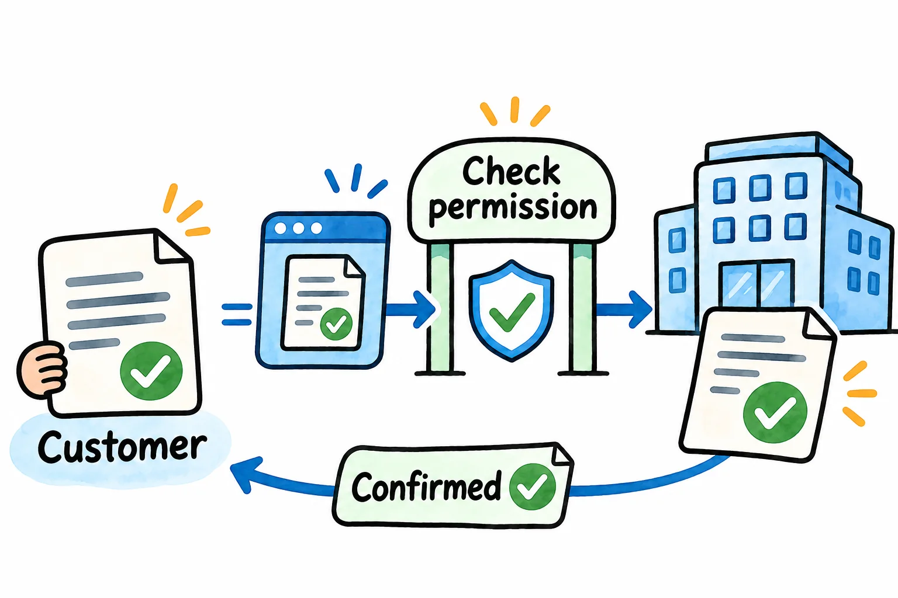
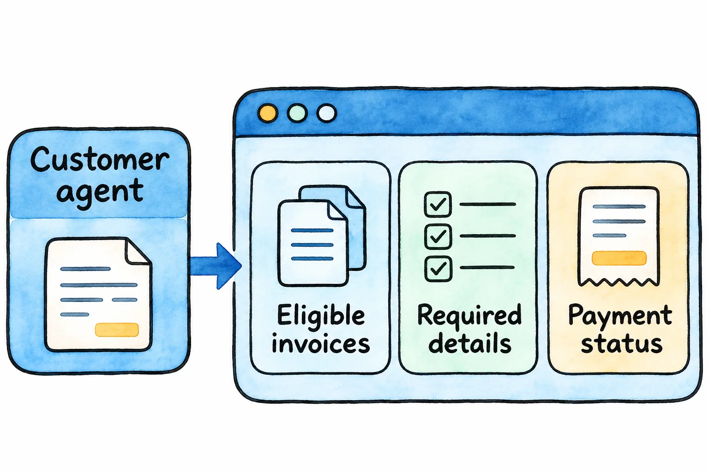
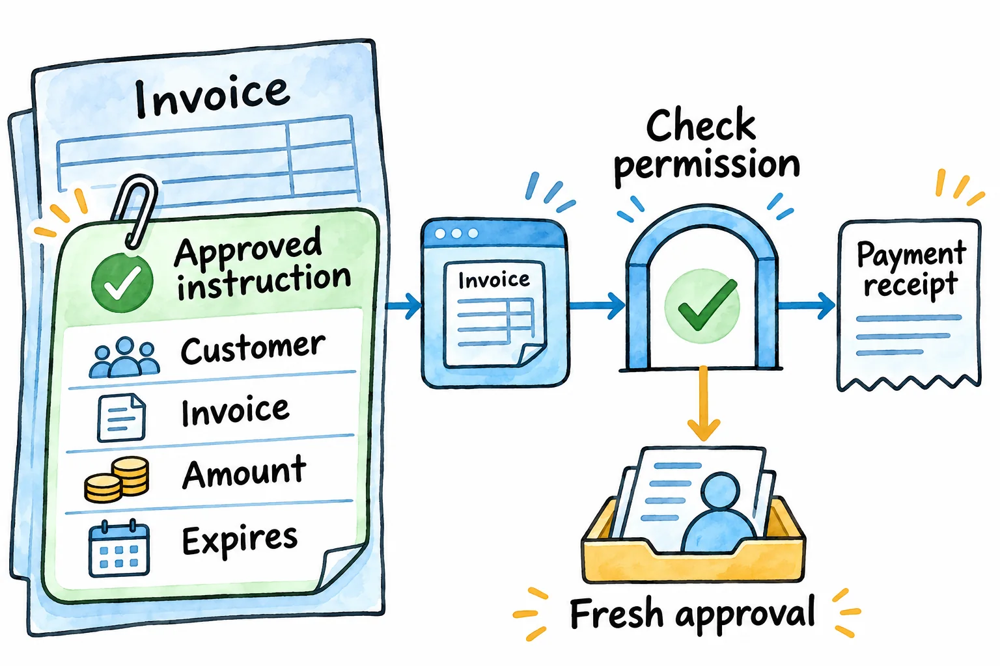
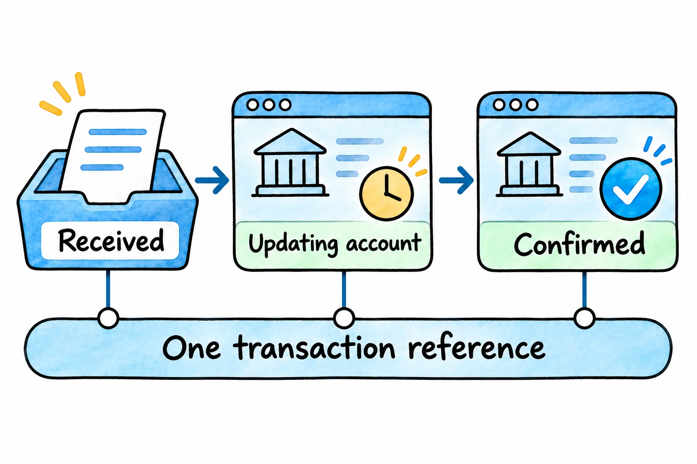

# When customers send AI agents: how enterprises should prepare

By [Jateen Narsai](/authors/jateen-narsai/)

*An authorised agent needs a permitted route into the service and a result the customer can verify.*

Take a routine supplier payment. The invoice is approved and the money's available. Someone in finance still has to open a portal, find the invoice and type in the payment details.

If you're responsible for that process, it's an easy task to put on the automation list. You'd like the payment handled without another interruption, and you need to be certain the right supplier gets the right amount.

On 20 October 2026, Visa, BILL and Billtrust [announced a live pilot](https://usa.visa.com/about-visa/newsroom/press-releases.releaseId.22856.html) addressing that portal step. An authorised AI agent completes payments the buyer has already approved, while the supplier's portal recognises the agent and applies its acceptance policy.

According to the announcement, participating businesses are already processing transactions through the pilot.

For enterprise leaders, that raises a practical question: how do you serve a customer who sends an agent to complete a request? Start with one service, working through what the agent may do and how both businesses will know the job is finished.

## Your next customer request could come from software

An AI agent uses software to carry out a task for someone. In the payment pilot, the buyer has made the spending decision; the agent carries out the approved payment.

The agent works for the customer. Your business still decides which requests it will accept.

The prediction is that more customers will delegate transactions this way. Mastercard's [September 2026 report on shopping and payments](https://www.mastercard.com/news/europe/en/newsroom/press-releases/en/2026/mastercard-report-predicts-that-one-in-10-people-will-routinely-use-ai-agents-to-shop-and-pay-by-2030/) presents futurists' predictions that more than 1 in 10 online shoppers will routinely use purchasing agents by 2030.

Treat that as a forecast about online shopping. It gives enterprise leaders a possibility to plan for, with adoption in their own markets still uncertain.

If customers begin delegating more business requests, your service will need to give their agents usable answers. Which invoices can be paid? What information is required, and what confirmation will the customer receive?

An account manager may be able to fill gaps in a conversation today. For an agent to complete the request reliably, those answers need to be available through the service itself.

We recommend preparing one clearly defined request first. The invoice-payment example below is an illustrative design: the proposed permissions, system connections and tests are recommendations for an enterprise considering this capability.

*Give an authorised agent clear information about eligible invoices, required details and the status of its payment request.*

## Be clear about whose permission counts

Recognising an agent is a starting point. You also need to know which customer it represents and what that customer has allowed it to do.

Think about a colleague asking you to pay an invoice. Knowing the colleague doesn't tell you whether the payment has been approved. An agent needs the same distinction built into the service.

In our illustrative payment service, permission might cover a named invoice, an approved amount and an expiry time. The agent could settle that invoice within those limits; a different invoice or payment destination would need separate authority.

Agree how permission will be checked and withdrawn. The service needs a way to verify approval, including when an agent's message confidently says the customer has already given it.

Understanding the customer's instructions takes care too. In [Project Swap](https://www.anthropic.com/research/project-swap), published in September 2026, Anthropic studied agents trading books for 201 employees. Missing information about people's preferences limited the results, even when the agents traded effectively.

The experiment was a controlled book exchange. It gives service designers a useful question to test: has the agent understood what its customer wants?

For the invoice service, write down:

- Which customer account and invoice the agent may access.
- What it may do, for how much and until when, including how the customer can withdraw permission.
- What needs fresh approval. An invoice amount changing after the original instruction is one example.
- What the agent receives when a request can't proceed, and which team takes over.

Now you have rules that business and technical people can check together, including the point where the service should stop and ask for a decision.

*Check the request against the customer’s permitted invoice, amount and time limit, with a route for fresh approval when needed.*

## Make “done” mean the same thing on both sides

The buyer wants to know the invoice is paid. Your systems need to give you enough evidence to confirm that outcome.

Follow the payment through the supplier's current process. Find the system holding the invoice, the system recording the payment and the point where the amount is applied to the customer's account.

Some connections may already exist. An application programming interface, or API, lets software exchange information or request an action from another system; yours may support part of the payment journey already.

Other steps may depend on someone comparing records or investigating a mismatch. Those steps need an owner and a way to pass on the information required to finish the job.

Then test the awkward cases. That's where you'll find out whether the service is ready for use:

- The agent receives no response and tries again. The service recognises the original request and avoids charging twice.
- The invoice amount changes after approval. The request pauses for the required decision, with a clear explanation returned to the agent.
- A payment is accepted, and the account update is delayed. The status explains what's been received and what's still waiting for confirmation.
- Someone needs to investigate. The responsible team gets the invoice, permission details, transaction reference and failure information (without asking the customer to start again).

These are proposed tests for the illustrative service. The implementation will depend on your payment arrangements and the systems involved.

*Keep receipt, account updates and confirmed completion distinct, using one reference to follow the request across systems.*

Give both businesses a transaction reference they can use to follow progress. During the first trial, measure completed requests, repeat attempts, unresolved cases and staff intervention, then compare them with the current process.

You'll need those results before deciding whether to extend the service.

## Next steps: prepare one service with Solvero

Choose one customer request you'd like to make easier to complete. Bring a successful example, a difficult one and the person who can explain how the decisions get made.

Through [Business Process Improvement](/services/business-operations-improvement/), we can follow the request through your business, clarify who can approve each action and work through the handoffs that cause delays. That establishes what needs to change before you commit to building it.

Our [New Business Capabilities](/services/new-business-capabilities/) work can take the agreed change through systems analysis, solution architecture, implementation, testing and handover. That might mean adding an interface for authorised requests, connecting existing applications and giving your team a clear way to handle cases that need attention.

We'll agree the permitted actions, system responsibilities and acceptance criteria with the people who will own the service.

[Bring Solvero one customer request](/#contact) you'd like an authorised agent to complete. We'll help you work out what the service needs and deliver the agreed change.
